# Relatório Técnico — Asclépio · Fase 4
### Tech Challenge · Fase 4 · FIAP Pós-Tech IA para Devs (8IADT) — Monitoramento multimodal

> **Hospital Universitário FIAP (fictício).** Sobre o assistente clínico das Fases 1–3 (LLM fine-tunada,
> LangChain/LangGraph, guardrails, RAG com fontes, auditoria), a Fase 4 acrescenta o **monitoramento
> contínuo do paciente com dados multimodais** — vídeo, áudio, texto e séries temporais — para
> identificar sinais precoces de risco e **alertar a equipe em tempo real**.
> Repositório: <https://github.com/rodrigogrosa/asclepio> · Checklist: [`EVIDENCIAS_FASE4.md`](EVIDENCIAS_FASE4.md) ·
> Roteiro do vídeo: [`ROTEIRO_VIDEO_FASE4.md`](ROTEIRO_VIDEO_FASE4.md).

**Resumo.** Implementamos um pacote multimodal (`multimodal/asclepio_multimodal`) e o integramos à
plataforma: (1) **vídeo** com **OpenPose** (pesos oficiais da CMU) sobre as pessoas encontradas pelo
**YOLOv8**, gerando relatórios automáticos de desvios em fisioterapia, quedas no quarto e eventos em sala
cirúrgica; (2) **áudio** de consultas com **Azure Speech to Text** e **Azure Text Analytics** (termos
críticos e sentimento), acústica da voz (Praat) e eventos sonoros com um modelo treinado no **AudioSet**;
(3) **detecção de anomalias em tempo real** em sinais vitais (dados reais do **PhysioNet**), prescrições e
mobilidade; (4) **fusão** das modalidades num risco único e explicável e (5) **alertas** que chegam à
equipe em tempo real. Todos os números deste relatório foram **medidos** e estão em
`multimodal/reports/*.json`; quando um resultado é fraco, dizemos.

---

## Sumário
1. [Contexto e objetivos](#1-contexto-e-objetivos)
2. [Fluxo multimodal](#2-fluxo-multimodal)
3. [Modelos aplicados em cada tipo de dado](#3-modelos-aplicados-em-cada-tipo-de-dado)
4. [Análise de vídeo](#4-análise-de-vídeo)
5. [Análise de áudio](#5-análise-de-áudio)
6. [Detecção de anomalias](#6-detecção-de-anomalias)
7. [Fusão e fluxo final do alerta à equipe médica](#7-fusão-e-fluxo-final-do-alerta-à-equipe-médica)
8. [Integração com o Azure](#8-integração-com-o-azure) · [8.1 Telas do sistema](#81-telas-do-sistema-prova-de-uso-real)
9. [Segurança, privacidade e auditoria](#9-segurança-privacidade-e-auditoria)
10. [Engenharia, testes e reprodução](#10-engenharia-testes-e-reprodução)
11. [Limitações e trabalhos futuros](#11-limitações-e-trabalhos-futuros)
12. [Conclusão](#12-conclusão)
13. [Referências](#13-referências)

---

## Checklist de conformidade com o edital da Fase 4

✅ concluído e provado · 🟡 depende de ação do aluno (gravação do vídeo)

| Exigência do edital | Status | Onde neste relatório | Evidência |
|---|---|---|---|
| **Vídeo:** processar vídeos clínicos (fisioterapia/cirurgia) | ✅ | §4 | tela **Monitoramento → Vídeo**; `video/pipeline.py` |
| **Vídeo:** movimentos/eventos fora do padrão com **OpenPose** (postural) | ✅ | §4.1–4.3 | `video/pose.py` (pesos COCO oficiais, MD5 conferido) |
| **Vídeo:** **YOLOv8** para objetos e áreas críticas | ✅ | §4.1–4.2 | `video/detect.py`, zonas por perfil |
| **Vídeo:** relatórios automáticos de desvios/falhas | ✅ | §4.4 | `report.md`, quadros e vídeo anotados por análise |
| **Áudio:** processar áudios de consultas | ✅ | §5 | **Monitoramento → Áudio**; `audio/pipeline.py` |
| **Áudio:** alterações vocais (cansaço, dificuldade respiratória) | ✅ | §5.3–5.5 | `audio/features.py`, `audio/vocal.py`, `audio/events.py`; VOICED |
| **Áudio:** **Azure Speech to Text** | ✅ | §5.1, §8 | `audio/azure_speech.py`; chamada real provada (§8) |
| **Áudio:** termos críticos e sentimentos com **Azure Text Analytics** | ✅ | §5.2, §8 | `audio/azure_text.py` (Health + sentimento); chamada real provada (§8) |
| **Anomalias:** séries de sinais vitais (FC, PA, SpO2) | ✅ | §6.1 | `anomaly/vitals.py`; PhysioNet/CinC 2009 |
| **Anomalias:** evolução de prescrições | ✅ | §6.2 | `anomaly/prescriptions.py` |
| **Anomalias:** padrões de movimentação na internação | ✅ | §6.3, §4 | `anomaly/mobility.py`; perfil *quarto* (quedas, URFD) |
| **Alertas automáticos** à equipe médica | ✅ | §7 | `/alerts/stream` (SSE), toast, `/alertas`, webhook opcional |
| **Objetivo:** fusão de texto, áudio e vídeo | ✅ | §2, §7 | `fusion.py`; painel multimodal do paciente |
| **Objetivo:** serviços em nuvem | ✅ | §8 | Azure AI Speech + Language (F0, brazilsouth), em uso pela plataforma |
| **Objetivo:** anomalias em **tempo real** | ✅ | §6.1, §7 | detector online + monitor ao vivo |
| **Datasets sugeridos** (PhysioNet, AudioSet) | ✅ | §3, §5, §6 | VOICED e CinC 2009 (PhysioNet); AST treinado no AudioSet |
| **Entregável:** código-fonte completo | ✅ | §10 | repositório + CI |
| **Entregável:** relatório (fluxo multimodal, modelos por dado, resultados, exemplos de anomalias) | ✅ | §2, §3, §4–§7 | este documento (+ PDF) |
| **Entregável:** vídeo ≤ 15 min (YouTube/Vimeo) | 🟡 | — | roteiro em [`ROTEIRO_VIDEO_FASE4.md`](ROTEIRO_VIDEO_FASE4.md) |

## 1. Contexto e objetivos

Com a IA já integrada aos processos médicos (análise de exames, documentos e apoio à decisão nas
fases anteriores), o hospital quer **monitorar continuamente** o paciente por dados multimodais para
achar **sinais precoces de risco**: desvios em sessões de fisioterapia ou cirurgias gravadas, sinais na
voz durante consultas (fadiga, disartria, desconforto respiratório) e anomalias em sinais vitais,
prescrições e evolução clínica, **alertando a equipe em tempo real**, com serviços gerenciados em nuvem
(Azure Cognitive Services).

Decisões de engenharia que guiaram a fase:

- **Um contrato para todas as modalidades.** Vídeo, áudio, séries e fusão devolvem o mesmo
  `AnalysisResult` (risco, achados com evidência, séries, modelos usados, artefatos). O backend persiste,
  alerta e funde sem saber qual modelo rodou.
- **Explicável antes de sofisticado.** Todo achado traz os números que o justificam (ângulo, z-score,
  jitter, termo e trecho) e uma recomendação. A equipe precisa entender *por que* foi alertada.
- **Nuvem quando agrega, local quando não há.** O Azure transcreve e analisa texto quando há chave; sem
  ela, a plataforma continua com Whisper e léxico clínico e avisa na tela.
- **Honestidade na avaliação.** Avaliamos em dados públicos reais (URFD, VOICED, PhysioNet, ESC-50) e
  registramos o que foi calibrado e o que é cego.

## 2. Fluxo multimodal

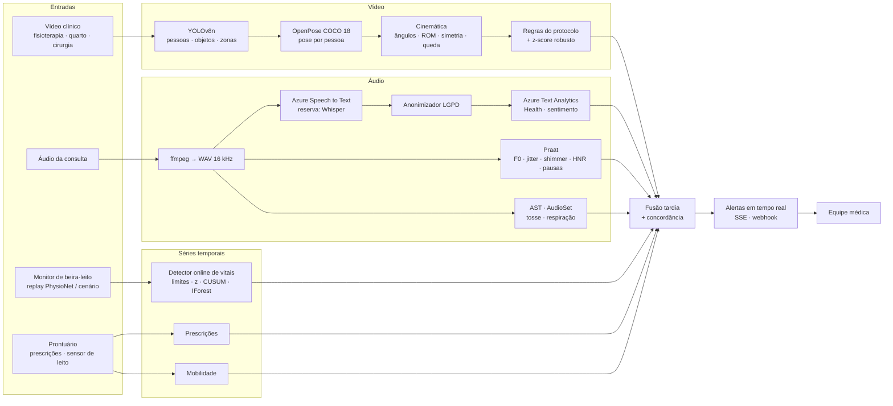

**Passo a passo de uma análise** (vídeo ou áudio enviados pela tela **Monitoramento**):

1. **Entrada validada.** Extensão permitida, tamanho conferido em blocos ao gravar (200 MB vídeo, 50 MB
   áudio) e conteúdo **decodificado** (OpenCV/ffmpeg) antes de aceitar. O arquivo vai para
   `data/uploads/<uuid>`, fora da área servida pela web, e o SHA-256 é registrado na auditoria.
2. **Fila.** A análise entra como `na_fila` e é processada uma por vez (OpenPose e AST disputam CPU). A
   tela mostra a etapa e o progresso ("Detectando pessoas e objetos (YOLOv8)", "Estimando a pose
   (OpenPose)", "Transcrevendo (Azure Speech)"…).
3. **Análise por modalidade** (§4 e §5), que devolve achados com evidência, séries para gráfico e artefatos.
4. **Alertas.** Cada achado de severidade *atenção* ou *crítico* vira alerta para a equipe (no máximo 6
   por análise; o relatório traz o resto), publicado em tempo real.
5. **Fusão** (§7) com as últimas análises do paciente (vídeo, áudio, sinais vitais, prescrições e
   mobilidade). A **concordância** entre modalidades gera um alerta próprio.
6. **Relatório automático**: Markdown, quadros-chave anotados, vídeo anotado H.264, gráficos.

O **monitor ao vivo** (§6.1) segue o mesmo caminho em fluxo contínuo: cada leitura de sinais vitais é
gravada no prontuário, passa pelo detector online e é publicada na tela; achados viram alertas no mesmo
instante.

## 3. Modelos aplicados em cada tipo de dado

| Dado | Modelo / serviço | Tarefa | Onde roda | Por quê |
|---|---|---|---|---|
| Vídeo | **YOLOv8n** (Ultralytics, COCO 80 classes) | Pessoas, objetos (celular, garrafa, cadeira…) e ocupação de zonas críticas | Local (CPU) | Pedido no edital; rápido (~0,04 s/quadro); a caixa da pessoa alimenta o OpenPose |
| Vídeo | **OpenPose COCO 18 pontos** (CMU, `pose_iter_440000`) via OpenCV DNN | Pose 2D por pessoa (top-down) | Local (CPU) | Pedido no edital; pesos oficiais sem compilar o OpenPose (ADR-0006) |
| Vídeo | Cinemática + **regras do protocolo** + **z-score robusto** | Ângulos, ROM, compensação de tronco, valgo, simetria, queda, imobilidade | Local | Explicável; o que foge do protocolo e o que foge do padrão do próprio paciente |
| Áudio | **Azure Speech to Text** (pt-BR, timestamps por palavra) | Transcrição da consulta | **Azure** | Pedido no edital; ritmo e pausas vêm do tempo de cada palavra |
| Áudio | Whisper-small (reserva) | Transcrição sem nuvem | Local | Continuidade sem chave/cota |
| Texto | **Azure Text Analytics** — **Text Analytics for Health**, sentimento com opinion mining, frases-chave | Termos críticos (sintomas, diagnósticos, medicamentos, com negação) e sentimento | **Azure** | Pedido no edital |
| Texto | Léxico clínico pt-BR com negação (reserva e mapeamento de severidade) | Termos críticos | Local | Continuidade; severidade institucional dos termos |
| Áudio | **Praat** (parselmouth) | F0, jitter, shimmer, HNR, pausas, taxa de articulação, grupos respiratórios | Local | Medidas acústicas clássicas da voz clínica |
| Áudio | **AST treinado no AudioSet** (`MIT/ast-finetuned-audioset`) | Tosse, respiração, chiado, espirro, pigarro | Local | Liga o projeto ao dataset sugerido (AudioSet) |
| Sinais vitais | **Detector online em camadas**: limites (NEWS2) · z-score robusto (mediana/MAD) · EWMA/CUSUM · **Isolation Forest** multivariado · antiflood | Anomalias em tempo real | Local | Explicável, calibrado por paciente, poucas amostras |
| Prescrições | Regras clínicas + pontuação de mudança inesperada | Salto de dose, dose máxima, alergia por classe, suspensão abrupta, duplicidade, instabilidade | Local | Mudança inesperada é regra clínica conhecida |
| Mobilidade | Regras + z-score robusto + Isolation Forest diário | Imobilidade ≥ 2 h, agitação noturna, saída do leito, queda | Local | Protocolos de lesão por pressão, delirium e queda |
| Multimodal | **Fusão tardia ponderada + concordância** | Risco único e alerta de concordância | Local | Modalidades com taxas diferentes; explicação preservada (ADR-0008) |

## 4. Análise de vídeo

### 4.1 Pipeline
1. Amostragem a 5 quadros/s (`VIDEO_SAMPLE_FPS`), com corte em 5 min.
2. **YOLOv8n** em cada quadro: pessoas e objetos. A pessoa principal é escolhida por confiança × área
   (o YOLO chegou a ver "pessoas fantasmas" em cadeiras e mochilas; ver §4.5).
3. **OpenPose COCO 18 pontos** no recorte de cada pessoa (top-down), máximo do *heatmap* com limiar de
   confiança, mapeado de volta ao quadro.
4. **Cinemática** com interpolação e suavização: ângulos de joelho, quadril, tronco (em relação à
   vertical), cotovelo e ombro; valgo dinâmico (plano frontal); simetria; altura do quadril e velocidade
   vertical; repetições por picos; amplitude (ROM) e tempo por repetição; vista estimada
   (frontal/lateral/oblíqua) para não medir valgo de perfil.
5. **Regras do perfil** e **z-score robusto** sobre as features por janela.
6. **Relatório**: quadros-chave anotados (esqueleto, caixas, zonas, rótulo), vídeo anotado H.264,
   gráficos de ângulo e de movimento, `report.md`.

### 4.2 Perfis e o que cada um detecta
| Perfil | Desvios/eventos | Severidade |
|---|---|---|
| **Fisioterapia** (agachamento, agachamento unipodal; dicionário `PROTOCOLOS` extensível) | Amplitude abaixo da esperada; inclinação excessiva de tronco (compensação); valgo dinâmico; assimetria; repetições inconsistentes (CV da ROM); oscilação lateral (equilíbrio); trechos atípicos para o próprio paciente | atenção / info |
| **Quarto** (internação) | **Queda** (descida brusca do quadril + corpo horizontal ou colapsado + permanência); imobilidade prolongada; agitação; saída do leito e pessoa no chão (com as zonas `leito`/`chao` definidas pela equipe) | crítico / atenção |
| **Cirurgia** | Lotação da área estéril; objetos não permitidos na área crítica (celular, garrafa, copo); entrada na zona crítica | atenção |

### 4.3 Resultados — quedas no quarto (UR Fall Detection Dataset)
Base pública com 30 quedas e 40 atividades do dia a dia (ADL), câmera 0, perfil *quarto*, 5 quadros/s
(`multimodal/reports/video_eval.json`).

| Conjunto | Vídeos | VP / FN / FP / VN | Sensibilidade | Especificidade | Acurácia | F1 |
|---|---|---|---|---|---|---|
| Todos | 70 | 27 / 3 / 2 / 38 | **0,90** | **0,95** | 0,929 | 0,915 |
| Fora da calibração (fall-21..30, adl-11..40) | 40 | 8 / 2 / 2 / 28 | 0,80 | 0,933 | 0,90 | 0,80 |

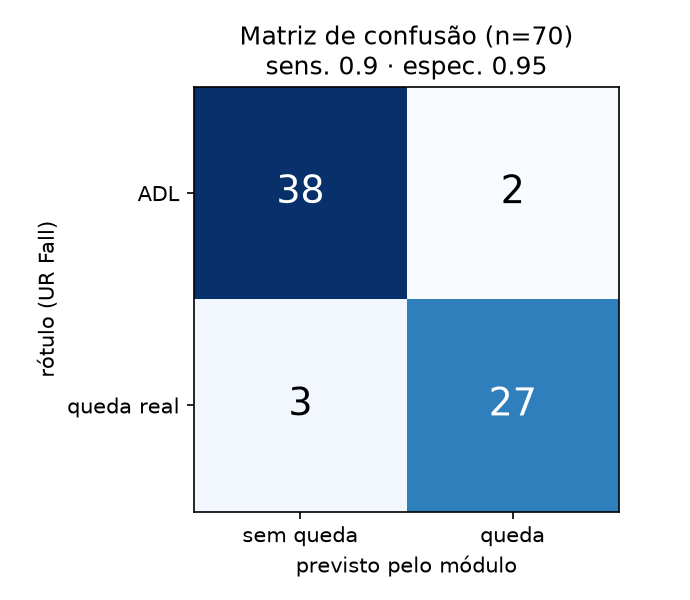

**Como chegamos aqui (transparência).** A primeira execução, com limiares definidos *a priori*, detectou
**12 de 30 quedas (sensibilidade 0,40)** e nenhum falso positivo nas 11 ADL processadas. Inspecionamos os
sinais de fall-01..20 e adl-01..10 e corrigimos quatro causas: janela de descida curta demais (1 s → 2 s),
queda no fim do vídeo sem tempo de confirmar a permanência (vira "possível queda"), trilha grudando numa
"pessoa fantasma" do YOLO e corpo colapsado (≥ 50 % mais baixo que em pé) não contado como deitado. O
subconjunto "fora da calibração" não foi usado para ajustar, mas não é 100 % cego: vimos acerto/erro de
alguns desses vídeos na primeira execução. Erros restantes: FN fall-18, fall-25, fall-27 (o YOLO não vê a
pessoa deitada ou o vídeo termina na queda); FP adl-31 e adl-35. Tempo médio de 16,5 s por vídeo
(0,57 s por quadro, com OpenPose em CPU, máquina compartilhada).

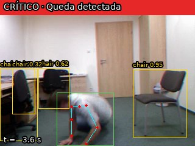

Exemplo real (`fall-01`): achado **`video.queda` — crítico**, descida de 0,8 da altura do corpo e
deitado por 1,6 s, quadro anotado aos 3,6 s; o alerta crítico chega à equipe com o trecho do vídeo.

### 4.4 Resultados — fisioterapia (vídeos CC do Wikimedia Commons)
Sem rótulo-ouro clínico: servem para mostrar que o pipeline mede o que deveria e que os achados batem com
o que se vê no quadro.

| Vídeo | Exercício | Repetições | Medidas | Achados |
|---|---|---|---|---|
| Squat – exercise demonstration (1280×720) | agachamento | 2 | flexão máx. do joelho 128°, vista oblíqua | nenhum desvio |
| Basic single leg squat (480×640) | agachamento unipodal | 2 | flexão máx. 115°, vista lateral | **`video.tronco_compensacao` (atenção)**: tronco a **72°** contra limite de 30°, de 4,2 a 6,8 s — inclinação à frente confirmada no quadro |
| Kettlebell Racked Squats, side view (640×480, 51 s) | agachamento | 6 | ROM média 142°, flexão máx. 148° | nenhum desvio; 1 trecho atípico informativo (início do vídeo) |

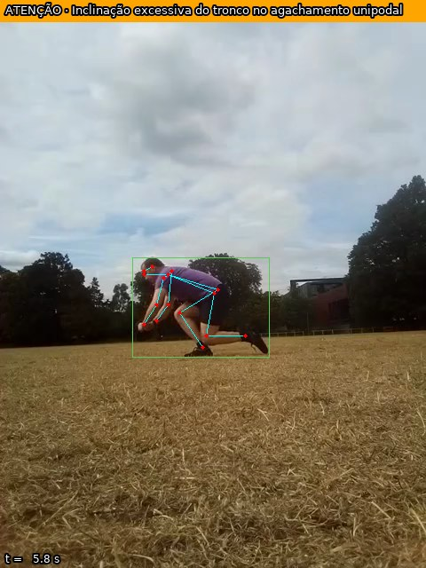

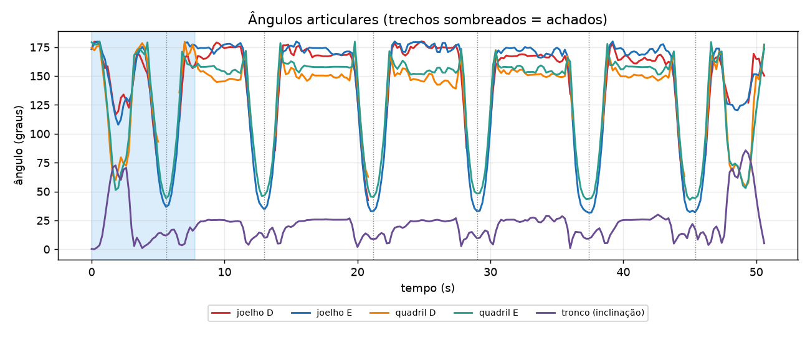

### 4.5 Limitações do vídeo
Pose 2D de uma câmera; nenhum vídeo de amostra tem vista frontal, então **valgo e assimetria só foram
verificados com esqueletos sintéticos** nos testes. Limiares são heurísticas registradas no relatório de
cada análise (`details.protocolo`), não validadas clinicamente. O UR Fall tem um único cenário e poucos
voluntários. Instrumental cirúrgico específico exigiria treinar o YOLOv8 com dataset rotulado (trabalho
futuro). O backend alternativo `yolov8-pose` existe, mas só o OpenPose foi exercitado ponta a ponta.

## 5. Análise de áudio

### 5.1 Transcrição — Azure Speech to Text
Reconhecimento contínuo do WAV (16 kHz mono, convertido com o ffmpeg estático do `imageio-ffmpeg`) em
**pt-BR**, com **timestamps por palavra** e confiança. O tempo das palavras alimenta o ritmo de fala e a
duração dos grupos respiratórios. Erro de autenticação ou cota vira aviso claro, e a análise cai para o
Whisper-small local (o relatório diz qual provedor rodou).

### 5.2 Termos críticos e sentimento — Azure Text Analytics
Antes de qualquer envio, a transcrição passa pelo **anonimizador do projeto** (nomes, CPF, telefone,
endereço; inclusive "meu nome é…" e "doutora …" ditos em voz alta); o relatório registra quantos itens
foram mascarados. Sobre o texto anonimizado:
- **Text Analytics for Health**: sintomas, diagnósticos e medicamentos com **asserções de negação**
  ("nega febre" não vira achado);
- **sentimento** geral e por frase, com *opinion mining*; **frases-chave**.
As entidades são mapeadas para a severidade institucional pelo léxico clínico (ex.: *dor no peito* e
*falta de ar* → crítico; *chiado*, *cansaço* → atenção). Sem chave, o mesmo léxico (com tratamento de
negação) faz o trabalho localmente.

### 5.3 Acústica da voz (Praat) e indicadores
Medidas: F0 (média, desvio e faixa em semitons), jitter, shimmer, HNR, intensidade, fração vozeada,
pausas ≥ 250 ms, taxa de articulação (núcleos silábicos, de Jong & Wempe 2009), razão de fonação e
duração dos grupos respiratórios. Indicadores de **triagem** (0–1) por z-score contra referências medidas:
**fadiga** (voz monótona, intensidade baixa, fala lenta, pausas longas), **dificuldade respiratória**
(frases curtas, pausas frequentes, voz soprosa, respiração audível) e **alteração articulatória**
(jitter/shimmer altos, articulação lenta e irregular). Referências: 110 leituras do **FLEURS pt-BR** (fala)
e os 57 saudáveis do **VOICED** (vogal); nessas falas sem queixa, os indicadores disparam em 1–6 %.

### 5.4 Eventos sonoros — AST treinado no AudioSet
Janelas de 1 s (salto de 0,5 s): tosse, respiração, chiado, suspiro, engasgo, pigarro, espirro.
Validação no **ESC-50** (metade A escolhe o limiar, metade B só mede):

| Evento | Recall (metade B) | Falsos positivos | Recall misturado à fala (+6 / 0 / −6 dB) |
|---|---|---|---|
| Tosse | 0,875 | 4 de 68 | 0,24 / 0,11 / 0,05 |
| Respiração | 0,789 | 5 de 65 | 0,39 / 0,33 / 0,28 |
| Espirro | 0,870 | 1 de 61 | 0,35 / 0,25 / 0,20 |

O detector é bom com o evento isolado e **perde muito quando o evento se sobrepõe à fala** — em consulta,
ele vale como evidência adicional, não como detector principal.

### 5.5 Resultados — alteração vocal em vozes reais (VOICED, PhysioNet)
208 vogais sustentadas (57 saudáveis, 151 patológicas: disfonia hipercinética, hipocinética, laringite de
refluxo). Regressão logística com 6 medidas, validação estratificada em 5 dobras:

| Classificador | AUC (IC 95 %) | Acurácia | Sensibilidade | Especificidade |
|---|---|---|---|---|
| 6 medidas (F0, jitter, shimmer, HNR…) | **0,615** (0,534–0,698) | 0,601 | 0,556 | 0,719 |
| Só jitter, shimmer e HNR | 0,605 | 0,558 | 0,51 | 0,684 |

AUC por medida: variação de F0 0,682; **jitter 0,650** (Mann-Whitney p < 0,001); HNR 0,645; shimmer 0,631.
**Leitura honesta:** as medidas separam os grupos acima do acaso, mas o classificador é **fraco** — a
acurácia fica abaixo de "chutar sempre patológico" (0,726) — e há confusão com idade (36,9 × 46,8 anos) e
sexo. Por isso a plataforma trata a voz como **triagem que soma evidência**, nunca como diagnóstico.

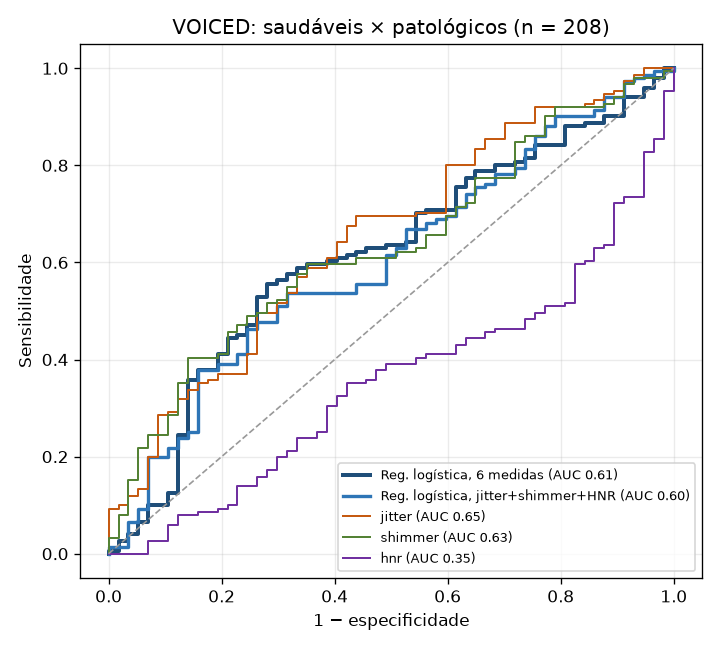

### 5.6 Exemplos — consultas de demonstração
Três consultas em pt-BR **sintetizadas com alterações controladas** (voz TTS, ritmo, F0 achatado, pausas
e inspirações inseridas) — servem de sanidade do pipeline, não de validação clínica:

| Áudio | Indicadores vocais | Termos críticos (texto) | Eventos (AST) | Risco |
|---|---|---|---|---|
| `consulta_normal` | nenhum | "cansaço"; *dor no peito*, *falta de ar* e *febre* **negados** (não viram achado) | — | moderado (0,38) |
| `consulta_fadiga` | **fadiga 0,58 (atenção)** | cansaço; tom negativo | — | alto (0,52) |
| `consulta_dispneia` | **dificuldade respiratória 0,57**; fadiga 0,58 | **falta de ar** e **dor no peito (críticos)**, chiado, cansaço | **respiração audível** (7 eventos) | **crítico (1,00)** |

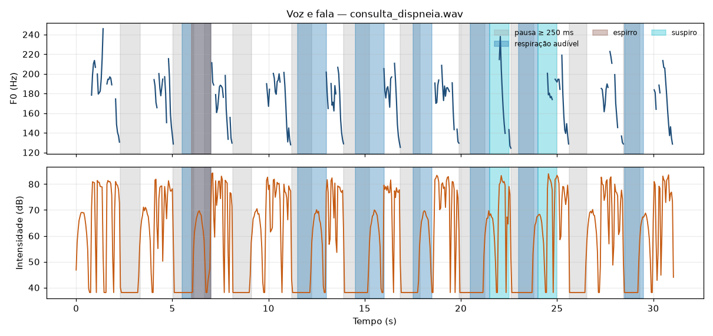

Tempo: 31 s de áudio analisados em ~35 s no Mac (Whisper local + AST + Praat); com o Azure, a transcrição
sai da máquina e o tempo cai.

## 6. Detecção de anomalias

### 6.1 Sinais vitais em tempo real
**Detector online** (`OnlineVitalsDetector`, um por paciente) a cada leitura:
1. **Limites fisiológicos** alinhados ao NEWS2 (já usado na revisão clínica da Fase 3) e índice de choque
   (FC/PAS);
2. **z-score robusto** (mediana/MAD, janela de 30 min) para mudanças bruscas;
3. **EWMA/CUSUM** para deriva (queda progressiva de PAM ou SpO2);
4. **Isolation Forest** multivariado ajustado nas 45 primeiras leituras **do próprio paciente**;
5. **Antiflood**: duração mínima, histerese, recuperação de 10 min e *cooldown* com recuo.

**Dados reais — PhysioNet/CinC Challenge 2009** (episódio hipotensivo agudo, MIMIC-II numéricos):
50 registros (19 com episódio, 31 controles), alerta hemodinâmico na janela T0−120 min a T0+60 min.

| Método | Sensibilidade | Especificidade | Antecedência média |
|---|---|---|---|
| Só limiar | 0,74 | 0,55 | 75 min |
| z-score robusto | 0,42 | 0,39 | 128 min |
| CUSUM/EWMA | 0,53 | 0,45 | 83 min |
| Isolation Forest | 0,21 | 0,65 | 60 min |
| **Ensemble (padrão do monitor)** | **0,84** (0,62–0,95) | 0,19 | 113 min |
| Política "2 famílias concordam" (só na avaliação) | 0,53 | 0,61 | 78 min |

**Leitura honesta:** o ensemble foi desenhado para **não perder** deterioração (sensibilidade 0,84,
alerta em média 113 min antes), e paga com especificidade baixa — pacientes de UTI têm muitas variações
fora do padrão que não evoluem para hipotensão. Para *prever* o episódio, o melhor preditor isolado
continua sendo a **PAM mínima** (AUC 0,89), contra 0,54 do escore composto e 0,56 do NEWS2 máximo: o
escore de anomalia mede "fora do padrão", não "vai ter hipotensão". A política "2 famílias concordam"
foi medida na avaliação (pós-processamento dos alertas); levá-la ao monitor como opção por unidade é
trabalho futuro (§11).

**Injeção controlada** (117 anomalias — pico de FC, deriva de PAM, dessaturação, FC↑+PAM↓ — sobre 31 linhas
de base reais):

| Método | Precisão | Recall | F1 | Atraso médio |
|---|---|---|---|---|
| Só limiar | 0,43 | 0,84 | 0,57 | 9,7 min |
| z-score robusto | 0,55 | 0,86 | 0,67 | 15,3 min |
| **CUSUM/EWMA** | **0,66** | 0,93 | **0,77** | 12,2 min |
| Isolation Forest | 0,62 | 0,22 | 0,33 | 12,4 min |
| Ensemble | 0,29 | **0,99** | 0,45 | **8,1 min** |

A deriva de PAM é avisada pelo ensemble em 18,7 min, contra 22,9 min do limiar puro. A precisão é um piso:
eventos reais da linha de base contam como falsos positivos.

**Antiflood** (398 h de registros reais): de **125,7 para 2,8 alertas/h (−97,8 %)** — a diferença entre
uma equipe que ignora o sistema e uma que o usa.

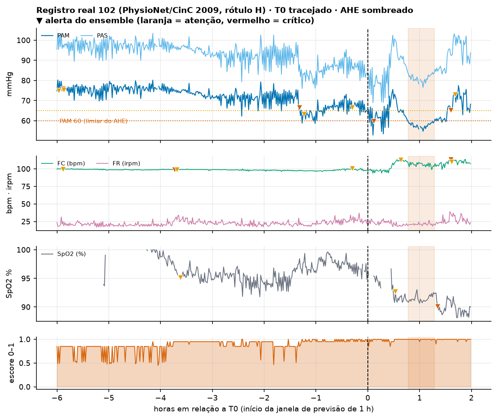

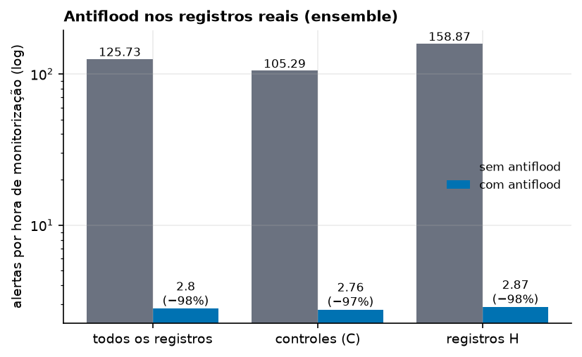

### 6.2 Evolução de prescrições
Regras: **salto de dose** (≥ 2×, ou ≥ 50 % em alta vigilância: insulina, heparina, KCl, morfina,
noradrenalina), **dose acima da máxima diária** de referência, **suspensão abrupta** de medicamento que
exige continuidade (anticoagulante, antibiótico antes do fim do curso, corticoide, betabloqueador),
**alergia por classe** (ex.: penicilina → amoxicilina/piperacilina), **duplicidade terapêutica** e
**instabilidade** (≥ 3 mudanças em 24 h), mais uma pontuação de mudança inesperada em relação ao histórico
do próprio paciente. Nos 24 pacientes sintéticos, com anomalias plantadas: **11 de 11 detectadas, 0 falsos
positivos** (e 120/120 numa varredura em 5 horários). **Ressalva:** o gabarito sai do mesmo gerador para o
qual as regras foram escritas — valida o pipeline, não a sensibilidade clínica.

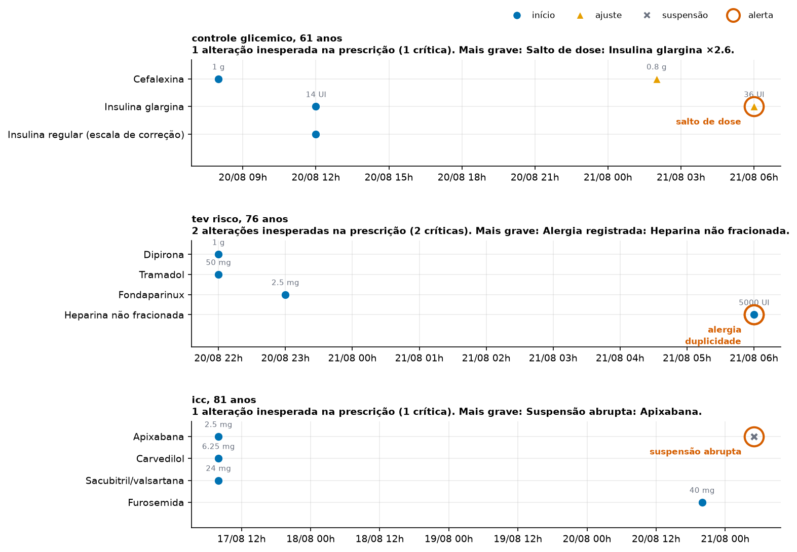

### 6.3 Padrões de movimentação na internação
Leituras do sensor de leito/câmera do quarto (atividade e posição a cada 15 min) e o vídeo do quarto (§4):
**imobilidade ≥ 2 h** sem mudança de decúbito (protocolo de lesão por pressão), **agitação noturna** acima
da linha de base diurna (indicador de delirium), **saída do leito à noite** (risco de queda), **queda**
(posição chão), **queda súbita de atividade** e **dia atípico** (Isolation Forest sobre features por hora).
Nos 24 pacientes sintéticos: **6 de 6, 0 falsos positivos**, com a mesma ressalva acima. Quedas reais em
vídeo: §4.3.

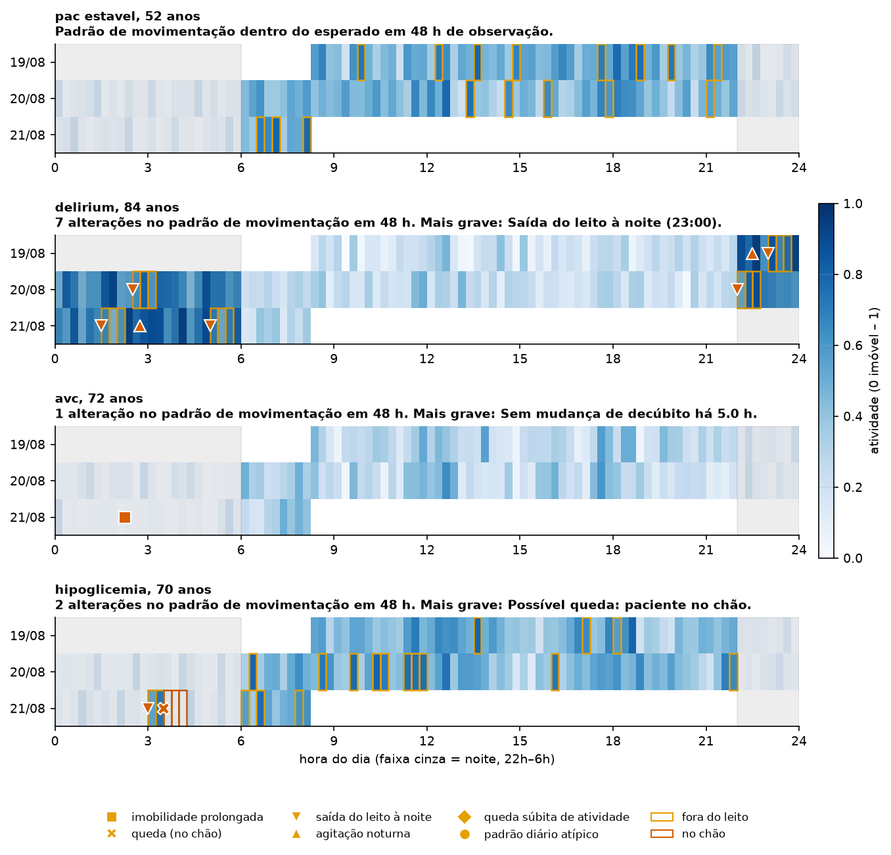

## 7. Fusão e fluxo final do alerta à equipe médica

### 7.1 Fusão tardia
`fusion.fuse()` combina as **últimas análises de cada modalidade** do paciente:
1. média ponderada dos riscos das modalidades presentes (sinais 0,30 · vídeo 0,20 · mobilidade 0,20 ·
   áudio 0,15 · prescrições 0,15), renormalizada;
2. **regra de segurança**: um achado crítico em qualquer modalidade leva o risco a crítico;
3. **concordância entre modalidades** no mesmo eixo clínico (respiratório, queda, neurológico,
   hemodinâmico): ex. "falta de ar" no áudio + queda de SpO2 nos sinais vitais vira o achado
   **"Sinais concordantes de desconforto respiratório (áudio + sinais vitais)"**, com +0,15 de risco.
   Fontes independentes concordando reduzem a chance de falso alarme — é o argumento a favor do
   monitoramento multimodal.
A tela do paciente mostra o risco fundido, a contribuição de cada modalidade e o que falta.

### 7.2 Do achado à equipe
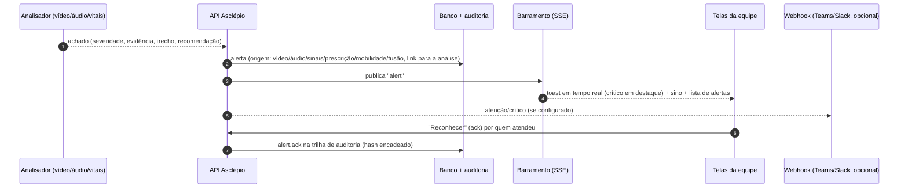
- **Tempo real**: `GET /alerts/stream` (Server-Sent Events) para quem tem `alerts:read`; reconexão
  automática; vale para alertas de qualquer origem (inclusive os fluxos clínicos da Fase 3).
- **Acionável**: o alerta diz o que aconteceu, o trecho (s) e a recomendação; abre a análise com o vídeo
  posicionado no instante do achado.
- **Sem tempestade**: antiflood no detector, *dedupe* de alerta aberto com o mesmo título e no máximo 6
  alertas por análise.
- **Rastreável**: criação, visualização da análise e reconhecimento ficam na auditoria encadeada.

## 8. Integração com o Azure

| Serviço | Uso | Configuração |
|---|---|---|
| Azure AI **Speech** (Speech to Text) | Transcrição pt-BR com tempo por palavra | `AZURE_SPEECH_KEY`, `AZURE_SPEECH_REGION` |
| Azure AI **Language** (Text Analytics) | Text Analytics for Health, sentimento, frases-chave | `AZURE_LANGUAGE_KEY`, `AZURE_LANGUAGE_ENDPOINT` |

- SDKs oficiais (`azure-cognitiveservices-speech` 1.53, `azure-ai-textanalytics` 5.3). `make azure-setup`
  cria os dois recursos **F0 (gratuitos)** em `brazilsouth` pela Azure CLI e grava as chaves no `.env`;
  `make azure-check` faz uma chamada real a cada serviço. Passo a passo pelo portal: [`GUIA_AZURE.md`](GUIA_AZURE.md).
- A tela **Monitoramento** mostra o estado da integração ("Azure conectado" × "modo local") e cada análise
  lista o provedor efetivo em "Modelos aplicados".
- **Prova real (28/10/2026)**, assinatura do aluno, recursos `asclepio-speech-*` e `asclepio-language-*`
  (F0, `brazilsouth`) criados por `make azure-setup`:
  - `make azure-check`: Speech transcreveu o áudio de exemplo; Language devolveu sentimento **negativo
    (0,87)** e o **Text Analytics for Health em português** reconheceu *falta de ar*, *dor no peito* e
    *febre* como `SymptomOrSign` — no tier gratuito.
  - **Análise pela plataforma** (consulta "falta de ar"): provedores `stt: azure` e `text: azure`, sem
    avisos; 34 palavras com tempo; o Text Analytics for Health marcou **"febre" como negada** e a tela a
    exibe riscada; sentimento negativo (0,9); 8 achados, risco crítico; ~1 min 53 s (o tempo é dominado
    pelo AST/AudioSet local em CPU).
  - O Azure transcreveu corretamente "Não tenho febre", trecho em que o Whisper local havia errado ("não ou
    tenho") — ganho concreto de qualidade. Também erra: "subo a escada" virou "sudo a escada", e o
    Health marcou "sudo a" como sintoma informativo (sem alerta, só destacado em pontilhado).
  - Assinatura nova precisa do provedor `Microsoft.CognitiveServices` registrado; o `make azure-setup`
    agora faz isso sozinho (antes falhava com `MissingSubscriptionRegistration`).

## 8.1 Telas do sistema (prova de uso real)
Capturas da plataforma rodando em Docker (`make up`), com os exemplos da tela **Monitoramento** — o mesmo
caminho descrito no roteiro do vídeo. As telas 01–08 foram capturadas antes de ligar o Azure (**modo
local**); as 10–12, depois do `make azure-setup`, com o **Azure conectado**.

| | |
|---|---|
| 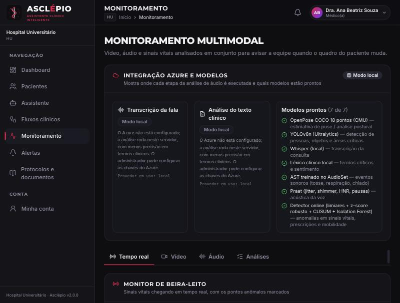 | 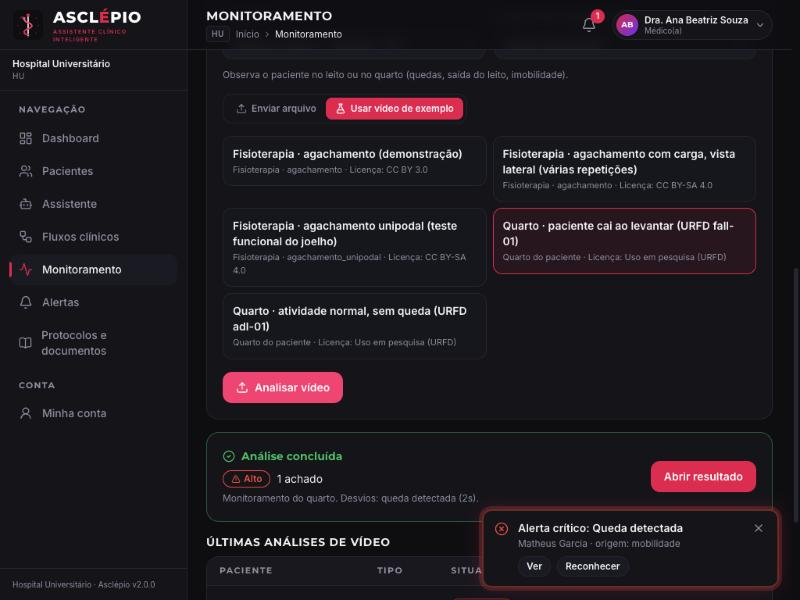 |
| Cabeçalho: integração Azure (modo local/conectado) e os 7 modelos prontos | Vídeo do quarto: queda detectada e o **alerta crítico chegando sozinho** |
| 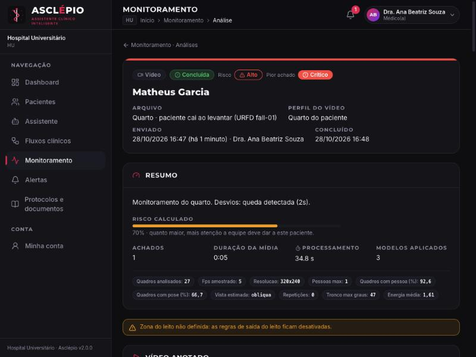 | 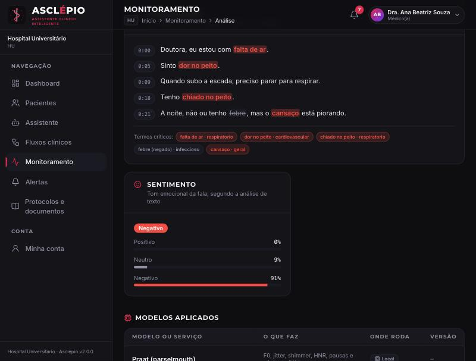 |
| Detalhe do vídeo: achado crítico, risco, métricas, vídeo anotado | Áudio: termos críticos destacados, indicadores vocais, sentimento |
| 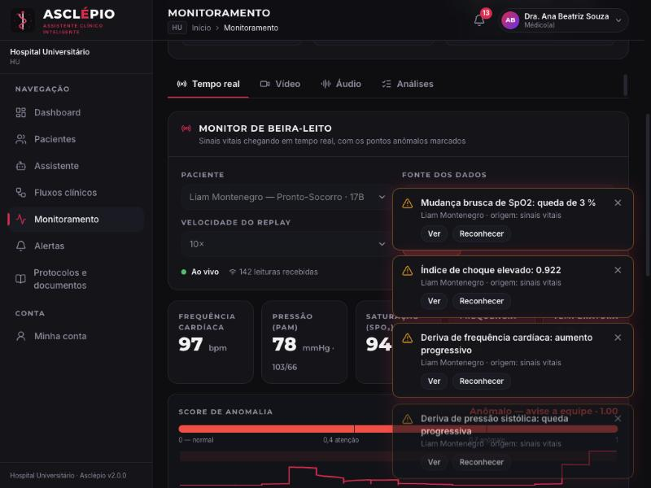 | 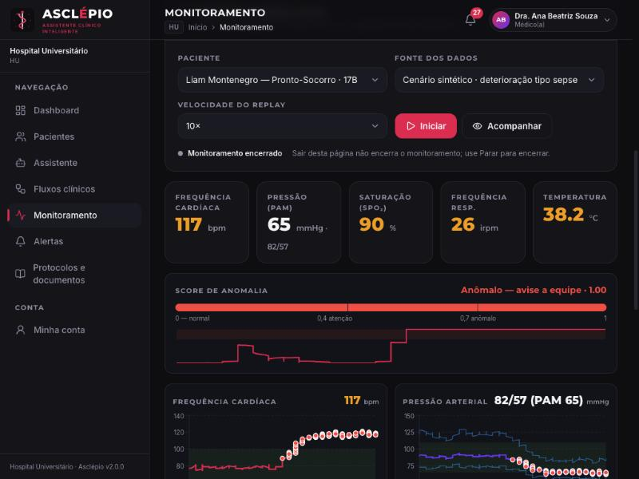 |
| Monitor de beira-leito: leituras chegando e alertas em tempo real | Fim da deterioração: FC 117, PAM 65, SpO2 90 %, pontos anômalos marcados |
| 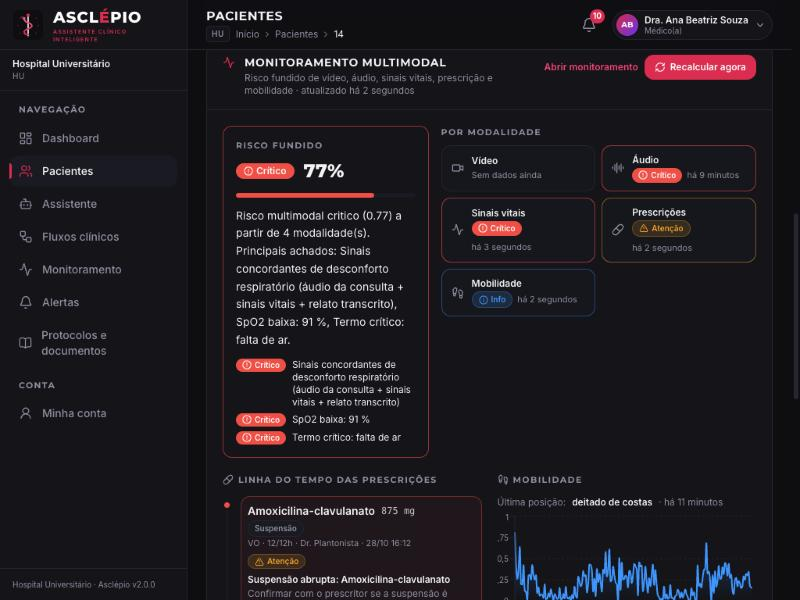 | 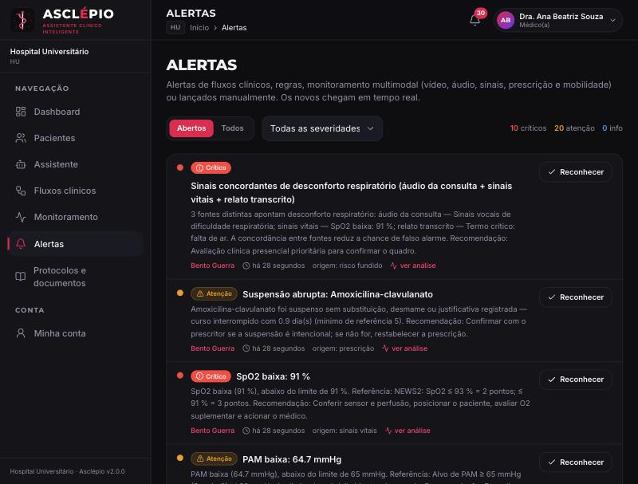 |
| Paciente: risco fundido e **concordância de 3 fontes** (áudio + sinais vitais + relato) | Alertas: origem, evidência, recomendação, "ver análise" e reconhecer |
| 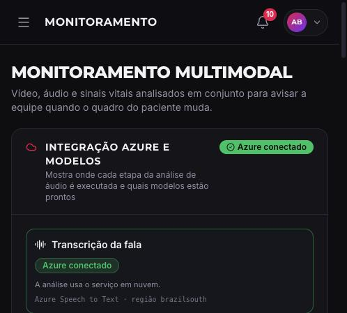 | 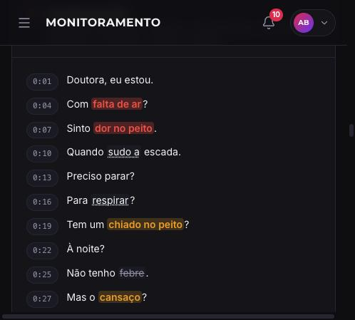 |
| **Azure conectado**: Speech to Text em `brazilsouth` | Transcrição do **Azure Speech** com termos do **Text Analytics for Health** por severidade; "febre" negada |
| 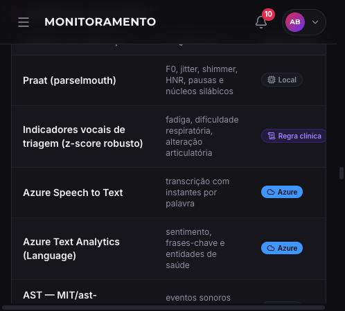 | |
| "Modelos aplicados": Azure Speech to Text e Azure Text Analytics rodando **no Azure** | |

Tempos medidos no container (CPU, Mac M5 Pro via Docker Desktop): vídeo de 5 s analisado em ~35 s
(OpenPose em CPU); consulta de 31 s em ~2 min com Whisper local — com o Azure, a transcrição sai da máquina.

## 9. Segurança, privacidade e auditoria
Detalhes em `docs/POLITICAS.md` §6.1 e ADR-0007.
- **Dado sensível (LGPD art. 11)**: vídeo e áudio de paciente ficam fora da área servida pela web, com
  nome trocado por UUID e SHA-256 auditado; abrir o resultado também é auditado.
- **Upload**: extensão, tamanho em blocos e decodificação antes de aceitar; artefatos servidos só pelo
  nome registrado no resultado e confinados ao diretório da análise (sem *path traversal*).
- **Nuvem**: só com chave; região Brasil; transcrição **anonimizada antes** do Text Analytics.
- **Perfis**: `monitoring:run` (médico, enfermagem, admin) envia e inicia o monitor; `monitoring:read`
  (inclui auditoria) só vê.
- **Alerta é apoio**: nenhum alerta altera prescrição ou prontuário; a conduta segue com a equipe (mesma
  premissa de validação humana da Fase 3).

## 10. Engenharia, testes e reprodução
- **Código**: `multimodal/asclepio_multimodal/` (`video/`, `audio/`, `anomaly/`, `fusion.py`, `schemas.py`),
  `backend/asclepio_api/services/monitoring.py` e `routers/monitoring.py`, telas em
  `frontend/components/monitoring/` e `frontend/app/(app)/monitoramento/`.
- **Testes**: 200 testes Python (core, API e multimodal) passando; os da Fase 4 rodam **sem rede e sem
  pesos** (modelos substituídos por fakes onde preciso), isolados do `.env` da máquina; frontend com
  `tsc`, `eslint` e `next build`. Tudo na CI (GitHub Actions), mais `gitleaks` e build das imagens.
- **Docker**: a imagem da API inclui OpenCV, Ultralytics, PyTorch **só-CPU** (índice CPU no Linux; evita
  ~3 GB de CUDA) e os SDKs Azure; o Praat é compilado no estágio *builder* em Linux ARM. Pesos e vídeos
  de exemplo são baixados sob demanda para `data/` e conferidos por SHA-256.
- **Reproduzir**:
```bash
make up              # sobe tudo (Web :3000, API :8000)
make fase4-assets    # baixa e confere OpenPose, YOLOv8 e vídeos de exemplo
make fase4-demo      # roda vídeo (queda, agachamento) e áudio (falta de ar) pela linha de comando
make fase4-eval      # refaz as avaliações (URFD, VOICED/FLEURS/ESC-50, PhysioNet) → multimodal/reports/
make azure-setup && make azure-check   # liga e confere o Azure
make test-multimodal # testes da Fase 4
```

## 11. Limitações e trabalhos futuros
- **Validação clínica**: limiares de vídeo, voz e prescrição são heurísticas documentadas; nenhum
  indicador foi validado com pacientes reais do hospital. Próximo passo: estudo retrospectivo com dados
  rotulados e calibração por unidade.
- **Especificidade do monitor de vitais** em pacientes graves (0,19 no ensemble): levar a política
  "2 famílias concordam" (medida na avaliação) ao detector online como opção, ou calibrar por unidade; usar a PAM mínima como preditor dedicado de hipotensão.
- **Voz**: classificador fraco no VOICED (AUC 0,62); referência de fala é leitura, não conversa
  espontânea; eventos sonoros perdem recall sob fala.
- **Vídeo**: pose 2D monocular; valgo/assimetria sem vídeo frontal real; instrumental cirúrgico exige
  treinar o YOLOv8 (ex.: m2cai16-tool) — fora do escopo.
- **Escala**: barramento de eventos em memória (um processo); com várias réplicas, Redis pub/sub;
  análises pesadas em *worker* dedicado (GPU).
- **Azure em produção**: contrato de operador (DPA) e RIPD; logs do serviço desabilitados.

## 12. Conclusão
A Fase 4 entrega o monitoramento multimodal pedido: vídeo com OpenPose e YOLOv8 gerando relatórios de
desvios, áudio com Azure Speech to Text e Text Analytics mais a acústica da voz, anomalias em tempo real
em sinais vitais, prescrições e mobilidade, fusão das modalidades e o alerta chegando à equipe na hora,
com rastreabilidade. Os resultados mostram onde o sistema é forte (quedas: sensibilidade 0,90 e
especificidade 0,95 no URFD; antiflood −97,8 %; deriva hemodinâmica detectada com antecedência) e onde
ainda é triagem (voz, especificidade do monitor em UTI) — e a arquitetura deixa claro como evoluir cada
parte sem mexer nas outras.

## 13. Referências
- Cao, Z. et al. *OpenPose: Realtime Multi-Person 2D Pose Estimation using Part Affinity Fields*. IEEE TPAMI, 2019 (modelo COCO `pose_iter_440000`).
- Jocher, G. et al. *Ultralytics YOLOv8*, 2023. <https://github.com/ultralytics/ultralytics>
- Kwolek, B.; Kepski, M. *Human fall detection on embedded platform using depth maps and wireless accelerometer*. Computer Methods and Programs in Biomedicine, 2014 (UR Fall Detection Dataset).
- Cesari, U. et al. *A new database of healthy and pathological voices*. Computers & Electrical Engineering, 2018 (VOICED, PhysioNet).
- Moody, G.; Lehman, L. *Predicting Acute Hypotensive Episodes: the 10th Annual PhysioNet/Computers in Cardiology Challenge*, 2009.
- Goldberger, A. et al. *PhysioBank, PhysioToolkit, and PhysioNet*. Circulation, 2000.
- Gemmeke, J. et al. *Audio Set: An ontology and human-labeled dataset for audio events*. ICASSP, 2017.
- Gong, Y.; Chung, Y.; Glass, J. *AST: Audio Spectrogram Transformer*. Interspeech, 2021.
- Piczak, K. *ESC: Dataset for Environmental Sound Classification*. ACM MM, 2015 (ESC-50).
- Conneau, A. et al. *FLEURS: Few-shot Learning Evaluation of Universal Representations of Speech*, 2022.
- Boersma, P.; Weenink, D. *Praat: doing phonetics by computer*; Jadoul, Y. et al. *Parselmouth*, 2018.
- de Jong, N.; Wempe, T. *Praat script to detect syllable nuclei and measure speech rate automatically*. Behavior Research Methods, 2009.
- Radford, A. et al. *Robust Speech Recognition via Large-Scale Weak Supervision* (Whisper), 2022.
- Liu, F.; Ting, K.; Zhou, Z. *Isolation Forest*. ICDM, 2008. Page, E. *Continuous inspection schemes* (CUSUM), 1954.
- Royal College of Physicians. *National Early Warning Score (NEWS) 2*, 2017.
- Microsoft. *Azure AI Speech* e *Azure AI Language — Text Analytics for health* (documentação oficial).
- Vídeos de demonstração (Wikimedia Commons): "Squat - exercise demonstration video" (CC BY 3.0);
  "Basic single leg squat" (CC BY-SA 4.0); "Kettlebell Racked Squats (side view)" (CC BY-SA 4.0).
